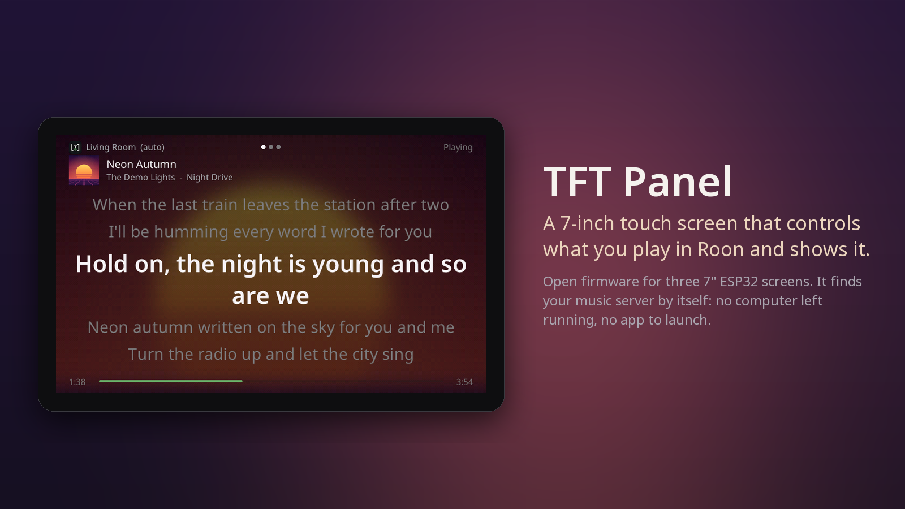
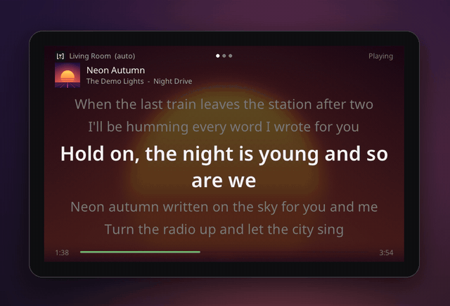

# TFT Panel

**A 7" touch screen that shows the synced lyrics of what you play in Roon — and lets you control it.**



TFT Panel is open firmware for 7" ESP32 touch screens — the **Elecrow CrowPanel 7.0"**, the
**Waveshare ESP32-P4 7B** and the **VIEWE ESP32-P4 7"** (see [Hardware](#hardware)). It displays the
lyrics line by line with the cover, and gives you play/pause, skip, volume and zone selection at a
touch. It gets what is playing in one of two ways: from the
[TextFromTrack Roon Companion](https://github.com/r45635/roon.app.textfromtrack.com) on your LAN,
which also finds and ranks the lyrics, or straight from your music server, with the lyrics coming
from a companion it finds by itself or from any LRCLIB-compatible server you point it at.

> 🚧 **Early development** — synced lyrics, cover view, touch controls and over-the-air updates work
> on the developer's panel; expect rough edges. See [docs/ROADMAP.md](docs/ROADMAP.md).

- Talks only to **your own** machines on your LAN — no cloud, no account, no lyrics stored on the device.
- Same open HTTP API as the companion's web player, and the panel's own page for what has to be typed.
- Weather and a news ticker on its clock face, if you want them.
- MIT licence ([details](#licence)).

*Roon is a trademark of Roon Labs. TFT Panel is an independent project, not affiliated with Roon Labs, Elecrow, Waveshare or VIEWE.*

<p align="center"></p>

*Pictures from the panel's showcase mode: the song, lyrics, zones and cover are invented.*

## Hardware

| | Elecrow CrowPanel 7.0" | Waveshare ESP32-P4 7B | VIEWE ESP32-P4 7" |
|---|---|---|---|
| Model | ESP32 Display 7.0", SKU **DIS08070H**, board **V3.0** | **ESP32-P4-WIFI6-Touch-LCD-7B** | **UEP4S070H1024V600C-WB-C** |
| Chip | ESP32-S3 (4 MB flash, 8 MB PSRAM) | ESP32-P4 (32 MB flash, 32 MB PSRAM) + ESP32-C6 for Wi-Fi | ESP32-P4 (16 MB flash, 32 MB PSRAM) + ESP32-C6 for Wi-Fi |
| Screen | 800×480 RGB, GT911 touch | 1024×600 MIPI-DSI, GT911 touch | 1024×600 MIPI-DSI (JD9165), GT911 touch |
| Build | `pio run -e crowpanel7` | `pio run -e waveshare-p4-7b` | `pio run -e p4-s070-wba` |

The interface is drawn on an 800×480 grid and scaled to the screen, so both look the same.

The two ESP32-P4 boards are flashed over USB for now: the web installer picks the firmware by chip, so
it cannot yet tell them apart — it gives any ESP32-P4 board the Waveshare one, which would leave a VIEWE
screen dark.

**Other screens are not supported**, even with the same chip and the same LCD controller: the
Guition JC1060P470C has the JD9165 of the VIEWE board and a different pin map, and the VIEWE bring-up
showed that sharing a controller is not sharing a configuration. Adding a board takes a new pin header
and **someone with the board to test it**: see [Other boards](docs/HARDWARE.md#other-boards).
Details, pin maps and pitfalls: [docs/HARDWARE.md](docs/HARDWARE.md).

## Install

**First time — from your browser, no tools to install.** Open the
[web installer](https://r45635.github.io/tft-panel/install.html) in Chrome or Edge on a computer, connect the
panel's USB-C port (on the Waveshare, the one marked *USB 1.1*), click *Install* and pick the serial
port; the installer picks the firmware for the screen it finds. On Windows the CrowPanel may need the
[CH340 driver](https://www.wch-ic.com/downloads/CH341SER_EXE.html).

**After that — over the air.** The panel checks for new releases by itself; when one is out, *Update*
appears at the top of the screen. Tap it and confirm: the panel downloads it, checks its checksum and
restarts. If the new version does not start properly, it goes back to the previous one by itself.

## Build and flash

Requires [PlatformIO](https://platformio.org/) (VS Code extension or `pio` CLI). The toolchain is
pinned in `platformio.ini` (pioarduino = Arduino-ESP32 3.3 on ESP-IDF 5.5).

```bash
pio run -e crowpanel7 -t upload           # CrowPanel: flash over USB-C (CH340, 460800 baud)
pio run -e waveshare-p4-7b -t upload      # Waveshare: flash over USB-C "USB 1.1" (native USB)
pio run -e p4-s070-wba -t upload          # VIEWE: flash over USB-C (CH340, 230400 baud)
pio device monitor                        # serial log and console, 115200
```

## First start

With no Wi-Fi configured, the panel opens its own network `TFT-Panel-XXXX` and shows two QR codes:
scan the first to join it, the second to open the setup page, then pick your Wi-Fi. You can also pick
the network and type its password on the panel itself.

Once it is on your network the companion is found automatically (Bonjour), and everything that has to
be typed — where the music comes from, the lyrics server, the weather town, a news feed — is on the
panel's own page at `http://tft-panel-xxxx.local`, which its settings screen shows as a QR code. The
page names the panel, its board, its address and its firmware, so several panels are told apart; a
change asks once for the six digits shown on that panel's screen, then remembers your browser.

## Documentation

- [User guide](docs/USER_GUIDE.md) — install, Wi-Fi setup, screens, gestures, settings, updates
- [Architecture](docs/ARCHITECTURE.md) — how the panel talks to the companion, firmware layers, technical choices
- [Hardware](docs/HARDWARE.md) — pin map, bring-up log, pitfalls
- [Roadmap](docs/ROADMAP.md)
- [Releasing](docs/RELEASING.md) — how a version is published (GitHub release + web installer)
- [Media kit](https://r45635.github.io/tft-panel/media-kit.html) — logos, pictures, video and texts for coverage

## Licence

TFT Panel is released under the [MIT licence](LICENSE) — code, documentation and media. The
firmware also contains third-party components under their own licences (Arduino core for ESP32:
LGPL-2.1; ESP-IDF: Apache-2.0; LVGL, ArduinoJson: MIT; Noto Sans: OFL 1.1): see
[THIRD_PARTY_NOTICES.md](THIRD_PARTY_NOTICES.md).
